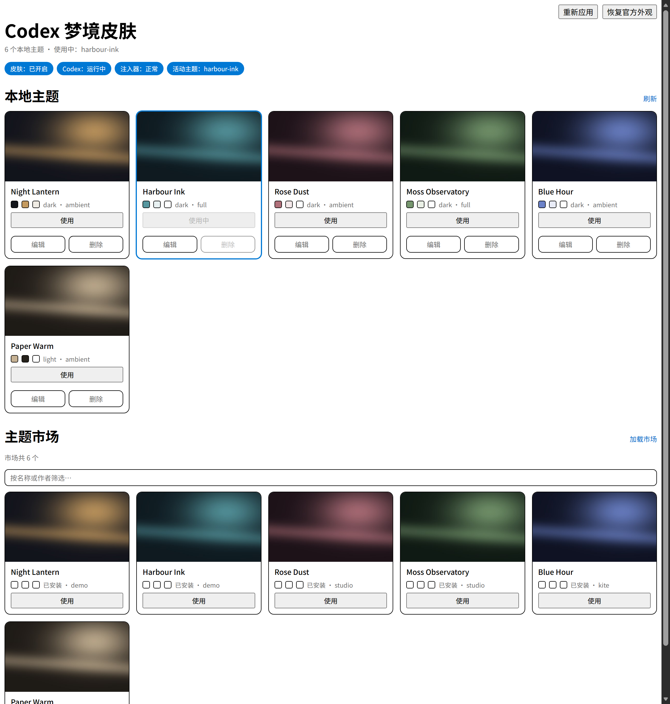

# Codex Dream Skin · a magpie plugin

Wallpaper themes for Codex, packaged as a [magpie](https://github.com/yetone/magpie)
plugin: it bootstraps its own skin engine, creates the launcher shortcut, and
manages themes — local and from the community market — from a page inside magpie.

> 中文说明: [README.md](./README.md)



## What it does

- **Real theming**, not a wallpaper pasted behind the UI: sidebar, main surface,
  composer and titlebar all get the theme's treatment.
- **14 themes included**, so a fresh install opens with a library
- **Back to stock** with one button — no uninstall, no restart.
- **Community market** — [dreamskin.cc](https://dreamskin.cc/gallery), the same
  catalog Codex++ uses (800+ themes): search, preview, download, apply.
- **Bootstrap** — on a machine with only magpie and Codex, enabling the plugin
  deploys the engine, seeds a default theme and creates the desktop shortcut.
- **Self-maintaining** — log rotation, archive and orphan cleanup, and a health
  pass that writes to the log only when something changes.

## Requirements

Windows 10/11 · Codex installed (the `OpenAI.Codex` MSIX package) · magpie
running. No administrator rights needed.

## Install

```powershell
git clone https://github.com/<you>/codex-dream-skin.git "$env:USERPROFILE\.config\magpie\plugins-local\codex-dream-skin"
magpie plugin add "$env:USERPROFILE\.config\magpie\plugins-local\codex-dream-skin"
magpie plugin on codex-dream-skin
```

Then launch Codex **from the desktop shortcut** the plugin creates — it is the
only entry point that passes the debugging port the injector needs. Open the page
from magpie's Plugins group.

## Theme market

The catalog comes from **https://dreamskin.cc** (/gallery to browse, /studio to author,
/docs for the package format, /download for the client), served by
https://api.dreamskin.cc/v1/themes — 880 themes at the time of writing.

Every theme declares a license in its manifest.json, chosen by its author. The spread is
uneven: about 41% MIT, 13% CC BY 4.0, the rest Personal Use / All Rights Reserved / Fan-Art,
plus a few values that are plainly junk. /docs notes that LICENSE.txt is reserved and unused
in the current version, so **the market has no blanket terms — the manifest is the terms**.

Downloading and using a theme is therefore between the user and its author. This plugin only
verifies a package (size + SHA-256) before installing it and redistributes nothing; the one theme
bundled in this repository is default-theme/, generated art. To check whether a theme may be
reused, read the license on its /themes/<versionId> page or in the package manifest.
## Why the shortcut matters

Codex is a Chromium app holding an exclusive lock on its `user-data-dir`. Close it
and immediately start it again and the new instance loses the lock race and exits
within seconds — no crash dump, no Windows error event, Sentry reporting
`status: ok, errors: 0`. The launcher waits for the previous instance to finish,
and starts Codex through its package identity so the taskbar keeps the app's own
logo instead of the icon embedded in the executable.

## Where things live

Everything is under `%LOCALAPPDATA%\CodexDreamSkin\`. Logs worth reading:
`plugin-autostart.log` (the plugin, including the health pass), `launch.log` (the
launcher's decisions), `codex-watch.log` (Codex process lifecycle).

The health pass runs every 10 minutes and writes only on change:

```
health: ok | workers=1 images=2/1MB previews=13+384 claims=30 log=1KB watch=62KB state=116KB injector=fresh
health: 1 issue(s) -- 3 worker processes sharing the lock (expected 1) | workers=3 ...
health: back to normal (was 1 issue(s)) | workers=1 ...
```

## How it is put together

The page runs in a sandboxed iframe (`allow-scripts`, `connect-src 'none'`), so it
has no network and no magpie API. Two channels remain:

```
read   <script src="state.js">          the worker writes state into the page folder
write  magpie.options.set({ request })  the page's only write channel
```

Writing options makes magpie tear down and re-create the plugin host, so state
travels through a file instead, and all long-lived work lives in `worker.mjs`,
which a host restart cannot interrupt.

## Tests

The three UI tests load the real page in headless Edge with a stubbed bridge, so
they touch neither magpie nor your configuration.

```powershell
cd tests
node ui-test.mjs
node ui-market-test.mjs
node ui-redraw-test.mjs
```

## License

[AGPL-3.0-only](./LICENSE). The engine scripts come from
[axdlee/Codex-Dream-Skin](https://github.com/axdlee/Codex-Dream-Skin) (MIT) and the
renderer and skin CSS from
[Fei-Away/Codex-Dream-Skin](https://github.com/Fei-Away/Codex-Dream-Skin) (MIT) —
both are the same Codex Dream Skin project.

The repository is AGPL-3.0 for one reason only: `engine/assets/safe-css.js` is a
port of the Safe CSS compiler from
[BigPizzaV3/CodexPlusPlus](https://github.com/BigPizzaV3/CodexPlusPlus) (AGPL-3.0).
Nothing else here comes from Codex++. Replace that one file and the rest can be MIT.

Attribution, the changes made to upstream, and what is deliberately excluded are in
[THIRD_PARTY.md](./THIRD_PARTY.md).

Unofficial. Not affiliated with OpenAI.