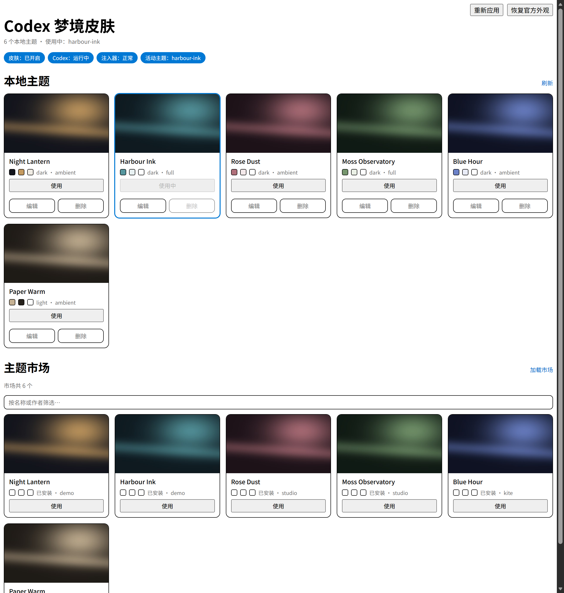

# Codex Dream Skin · magpie 插件

给 Codex 换壁纸皮肤，做成 [magpie](https://github.com/yetone/magpie) 插件：
装好后自带引擎、自动建快捷方式、**预置 14 个主题（默认周青眉）**、在 magpie 侧栏里管理，还能从社区市场挑。

> English: [README.en.md](./README.en.md)



## 能做什么

- **一行主题换肤**：侧栏、主区、输入框、标题栏整体换掉，不是贴一张背景图
- **恢复官方外观**：一个按钮回到 Codex 原生 UI，不用卸载、不用重启
- **社区主题市场**：从 [dreamskin.cc](https://dreamskin.cc/gallery)（Codex++ 用的同一个市场，
  当前 800+ 主题）搜索、预览、下载、一键应用
- **自举**：只装 magpie 和 Codex 的机器，启用插件后自动部署引擎、铺默认主题、建桌面快捷方式
- **后台自维护**：日志轮转、归档清理、孤儿预览清理、健康自检，全部在后台写日志，不打扰你

## 系统要求

| 项 | 要求 |
| --- | --- |
| 系统 | Windows 10 / 11 |
| Codex | 已安装（`OpenAI.Codex` 包，Microsoft Store / MSIX 版） |
| magpie | 已安装并运行 |
| 权限 | 普通用户即可，不需要管理员 |

## 安装

### 1. 拿到插件目录

```powershell
git clone https://github.com/<you>/codex-dream-skin.git "$env:USERPROFILE\.config\magpie\plugins-local\codex-dream-skin"
```

也可以直接下载 ZIP 解压到 `%USERPROFILE%\.config\magpie\plugins-local\codex-dream-skin`。

### 2. 装进 magpie

```powershell
magpie plugin add "$env:USERPROFILE\.config\magpie\plugins-local\codex-dream-skin"
magpie plugin on codex-dream-skin
```

如果 `magpie` 不在 PATH 里，用完整路径调用 magpie 的可执行文件。

### 3. 用桌面图标启动 Codex

启用插件后几秒内，桌面和开始菜单会出现 `Codex` 快捷方式。**以后只用它启动 Codex。**

原版开始菜单入口不经过启动器，没有 CDP 参数，皮肤挂不上去。

快捷方式是这样建出来的：

| 项 | 值 |
| --- | --- |
| 位置 | `桌面\Codex.lnk` + `开始菜单\程序\Codex.lnk` |
| 目标 | `wscript.exe "<%LOCALAPPDATA%>\CodexDreamSkin\launch-codex-hidden.vbs"`（无控制台闪窗） |
| 图标 | 从你自己的 Codex 安装里取 `chatgpt-tray-light.ico`，存到状态根 |
| 起始位置 | 状态根 |

bootstrap 每 6 小时会重跑一次，所以**删掉的图标会自己回来**。不想让它建：

```powershell
New-Item "$env:LOCALAPPDATA\CodexDreamSkin\no-shortcuts.flag"
```

### 4. 打开页面

magpie 窗口的 Plugins 分组里点「Codex 梦境皮肤」。

## 使用

| 操作 | 说明 |
| --- | --- |
| 点主题卡片的「使用」 | 立刻切换，Codex 不用重启 |
| 「恢复官方外观」 | 创建暂停标记，注入器下一轮把皮肤撤掉；点「应用皮肤」恢复 |
| 「加载市场」 | 拉取社区目录，支持按名称/作者搜索，分批显示 |
| 「安装」 | 下载主题包 → 校验大小与 SHA-256 → 安装 → 自动应用 |
| 「刷新」 | 重新生成预览图 |

预览图由插件自己下载生成（页面沙箱禁止联网，图片必须先在页面目录里）。翻页时按需补图，
不锁界面。

## 主题市场

目录来自 **https://dreamskin.cc**（/gallery 浏览、/studio 制作、/docs 包格式、/download 客户端），
接口是 https://api.dreamskin.cc/v1/themes，当前 880 个主题。

每个主题的 manifest.json 里都有 license 字段，由作者自己填写，实际分布很杂：MIT 约 41%、
CC BY 4.0 约 13%，其余是 Personal Use / All Rights Reserved / Fan-Art 等，还有少量乱填的值。
/docs 说明了 LICENSE.txt 是"预留、当前版本不使用"，也就是**市场没有统一条款，一切以 manifest 为准**。

所以：**下载并按 manifest 使用是用户与作者之间的事**，本插件只负责校验完整性（大小 + SHA-256）后安装，
不做再分发。本仓库捆绑的主题只有 default-theme/，是生成的原创图。

选主题前想确认能不能二次使用，看它 /themes/<versionId> 页面或包里 manifest 的 license。
## 为什么用桌面图标启动

Codex 是 Chromium 应用，对 `user-data-dir` 持独占锁。**关闭后立刻重启会抢不到锁，新实例几秒内
静默退出**——没有崩溃转储、没有 Windows 错误事件，Sentry 记的是 `status: ok, errors: 0`。
这就是「关掉再开就没了」的真正原因。

`launch-codex.ps1` 做两件事：

1. 等待上一个实例彻底退出（有窗口就直接激活到前台，不再启动第二个）
2. 通过 **包激活** 启动，同时传入 `--remote-debugging-port`，注入器才连得上

包激活还决定了任务栏图标：走包激活会带上应用身份，任务栏显示应用注册的 Logo（白色结，和
托盘一致）；直接跑 exe 会退回 exe 内嵌的图标（蓝徽章）。

## 数据放在哪

`%LOCALAPPDATA%\CodexDreamSkin\`

| 路径 | 内容 |
| --- | --- |
| `engine\` | 引擎（脚本 + 渲染资产） |
| `themes\<id>\` | 主题库 |
| `active-theme\` | 当前生效的主题 |
| `images\` | 每次切换归档的背景副本（自动清理） |
| `paused` | 存在即表示「恢复官方外观」 |
| `settings.json` | 端口等少量设置 |
| `launch-codex.ps1` / `launch.log` | 启动器与它的决策记录 |
| `plugin-autostart.log` | 插件日志（含健康自检） |
| `codex-watch.log` | Codex 进程生命周期记录 |

卸载：`magpie plugin off codex-dream-skin`，再删掉这个目录即可。

## 出问题时看这里

```powershell
$s = "$env:LOCALAPPDATA\CodexDreamSkin"
Get-Content "$s\plugin-autostart.log" -Tail 30   # 插件与健康自检
Get-Content "$s\launch.log" -Tail 20            # 启动器决策
Get-Content "$s\codex-watch.log" -Tail 30       # Codex 进程生死
```

健康自检每 10 分钟跑一次，**只在出问题或恢复时写日志**，正常时每天留一条基线：

```
health: ok | workers=1 images=2/1MB previews=13+384 claims=30 log=1KB watch=62KB state=116KB injector=fresh
health: 1 issue(s) -- 3 worker processes sharing the lock (expected 1) | workers=3 ...
health: back to normal (was 1 issue(s)) | workers=1 ...
```

排查时可临时提高频率：`$env:CODEX_DREAM_SKIN_HEALTH_MS = "3000"`。

| 症状 | 先看 |
| --- | --- |
| 皮肤没生效 | `injector=fresh` 是否为 `true`；Codex 是否用桌面图标启动 |
| 页面空白 / 没主题 | `state.js` 是否在 `page\` 下、是否新鲜 |
| 任务栏图标是蓝徽章 | Codex 是不是被直接跑 exe 启动的（走了 `Start-Process` 回退） |
| 关掉再开就闪退 | `launch.log` 里有没有 `waiting` 记录 |

## 端口

默认 `9335`。改的话只有一个权威值：`worker.mjs` 里的 `PORT`，也可以用环境变量
`CODEX_DREAM_SKIN_PORT` 覆盖。PowerShell 脚本都接受 `-Port` 参数，默认值与之一致。

## 开发

```
index.mjs                 magpie 插件入口（只负责拉起 worker）
worker.mjs                长活进程：自举、守护、命令、状态发布、自检
page/                     页面（沙箱 iframe，读 state.js，写 options.request）
engine/scripts/           引擎脚本（控制、自举、守护、进程记录）
engine/assets/            渲染资产（来自 Codex++，见 THIRD_PARTY.md）
launcher/                 启动器（无窗口包装 + 包激活）
themes/                   随插件附带的 14 个主题（来源见 themes/PROVENANCE.md）
tests/                    无头浏览器测试
```

### 架构要点

页面跑在 `allow-scripts` + `connect-src 'none'` 的 iframe 里，拿不到网络也拿不到 magpie API。
剩下两条通道：

```
读   <script src="state.js">            宿主把状态写进页面目录，脚本标签能取
写   magpie.options.set({ request })    页面唯一的写入通道
```

写 options 会**重建 magpie 的插件宿主**，所以：

- 状态回传走文件，不走 options（否则宿主启动时再写 → 重载循环）
- 命令处理放在独立的 `worker.mjs` 里，宿主怎么重建都打不断它

### 测试

```powershell
cd tests
node ui-test.mjs          # 切换状态机（按钮什么时候该禁用）
node ui-market-test.mjs   # 市场预览按需加载
node ui-redraw-test.mjs   # 状态不变时不该重建卡片
```

测试用无头 Edge 加载真实页面、桩掉 bridge，不需要 magpie 也不改你的配置。

## 许可证

[AGPL-3.0-only](./LICENSE)。引擎脚本来自 [axdlee/Codex-Dream-Skin](https://github.com/axdlee/Codex-Dream-Skin)（MIT），
渲染器与皮肤 CSS 来自 [Fei-Away/Codex-Dream-Skin](https://github.com/Fei-Away/Codex-Dream-Skin)（MIT），
两者都是同一个 "Codex Dream Skin" 项目。

仓库之所以是 AGPL-3.0，只因为 `engine/assets/safe-css.js` 是从
[BigPizzaV3/CodexPlusPlus](https://github.com/BigPizzaV3/CodexPlusPlus)（AGPL-3.0）移植的
Safe CSS 编译器 —— 除此之外没有 Codex++ 的东西。把这个文件换掉，其余部分就可以改成 MIT。

完整归属、对上游的修改说明、以及「刻意不包含的内容」见 [THIRD_PARTY.md](./THIRD_PARTY.md)。

本项目与 OpenAI 无关联。